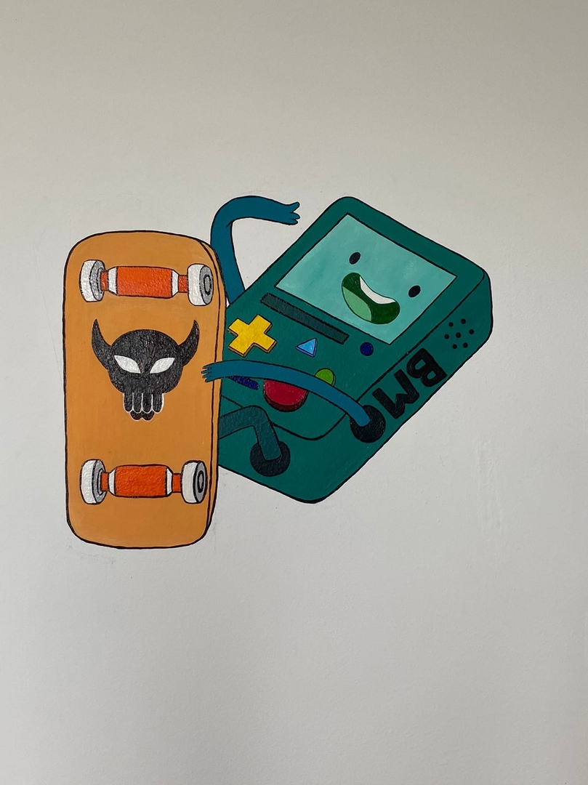
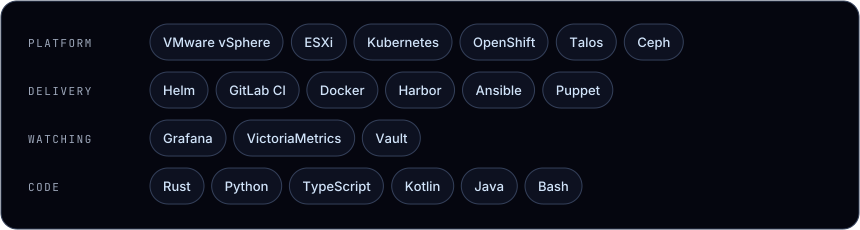

## What are u search in my profile?

Pick your answer. Every row opens.

<b>An app</b>

 

Screen, notifications, clipboard and webcam of an Android phone on your computer: [SeamDroid](#projects).

<b>What I write code in</b>

 

Mostly Rust. The full list is in [Stack](#stack).

<b>A calculator on a skateboard</b>

 

You came to the right profile.

<b>Nothing, just looking</b>

 

Sure?

<b>Yes, sure</b>

 

Really sure? There is nothing further down.

<b>Open it anyway</b>

 

Told you.

 

## Projects

## Stack

## Desk

